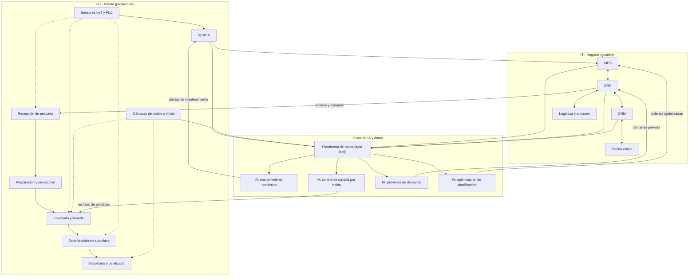

# 3. Diagrama Mermaid: estructura IT/OT y papel de la IA

## Lectura del diagrama
- **OT (arriba):** línea de producción con sensores, visión artificial y SCADA.
- **IT (abajo):** sistemas de gestión: MES, ERP, CRM, logística y venta online.
- **Capa de IA (centro):** recibe datos de ambos mundos y devuelve decisiones a cada uno (alertas, rechazos, previsiones, órdenes).
